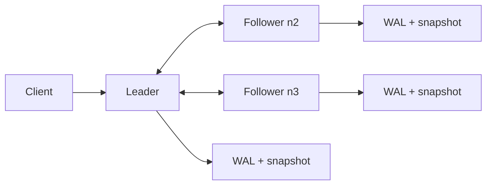

# QuorumKV

A distributed key-value database project in Go. Its deterministic local state machine is implemented; Raft, networking and persistence remain planned.

Un progetto di database key-value distribuito in Go. La macchina a stati locale deterministica è implementata; Raft, rete e persistenza restano previsti.

**Status / Stato — 19 November / novembre 2026:** **M01 COMPLETED**. Local PUT/GET/DELETE/CAS and quota tests pass / operazioni locali e test quote superati. **M02 not started / non iniziata.** Distributed guarantees and a running server are not available / garanzie distribuite e server utilizzabile non disponibili.

Planned distributed architecture / Architettura distribuita prevista:



Three local processes; majority 2/3. Roles change through elections. All processes share one Mac and SSD, so physical high availability is outside the guarantee.

Tre processi locali; maggioranza 2/3. I ruoli cambiano con le elezioni. Tutti condividono Mac e SSD: nessuna garanzia di alta disponibilità fisica.

| English | Italiano |
|---|---|
| **Engineering goals:** verifiable Raft safety, linearizability, crash recovery, deterministic testing and explicit trade-offs. | **Obiettivi ingegneristici:** safety Raft verificabile, linearizzabilità, crash recovery, test deterministici e trade-off espliciti. |
| **Planned features:** PUT, GET, DELETE, atomic CAS, durable replication, bounded deduplication, WAL, snapshots and local diagnostics. | **Funzioni previste:** PUT, GET, DELETE, CAS atomico, replica durevole, deduplicazione limitata, WAL, snapshot e diagnostica locale. |
| **Stack:** Go + standard library, HTTP/JSON over TCP, local filesystem, Git, Markdown and Mermaid. No external Raft library. | **Stack:** Go + libreria standard, HTTP/JSON su TCP, filesystem locale, Git, Markdown e Mermaid. Nessuna libreria Raft esterna. |
| **Constraints:** €0 additional spending, existing MacBook Pro M5/32 GB, loopback, offline after tool installation, short bounded tests. | **Vincoli:** 0 € aggiuntivi, MacBook Pro M5/32 GB già disponibile, loopback, offline dopo installazione strumenti, test brevi e limitati. |

## Documentation / Documentazione

| Italiano | English |
|---|---|
| [M01: implementazione e risultati](docs/it/milestone-m01.md) | [M01: implementation and results](docs/en/milestone-m01.md) |
| [Documentazione completa](docs/it/README.md) | [Complete documentation](docs/en/README.md) |
| [Requisiti e tracciabilità](docs/it/traceability.md) | [Requirements and traceability](docs/en/traceability.md) |
| [Audit: approvato con condizioni](docs/it/architecture-review.md) | [Audit: approved with conditions](docs/en/architecture-review.md) |
| [Architettura](docs/it/architecture.md) | [Architecture](docs/en/architecture.md) |
| [Roadmap 4–6 mesi](docs/it/implementation-roadmap.md) | [4–6 month roadmap](docs/en/implementation-roadmap.md) |
| [Decisioni ADR](docs/it/adr/README.md) | [Architecture decisions](docs/en/adr/README.md) |
| [Revisione e questioni aperte](docs/it/design-review.md) | [Review and open questions](docs/en/design-review.md) |
| [Consegna e inventario file](docs/it/delivery-report.md) | [Delivery and file inventory](docs/en/delivery-report.md) |

M01 provides a sequential, in-memory package with no external dependency. Its 12 tests and 44 subcases pass, including three repeated runs; the implemented package has 100% statement coverage. This is not evidence of distributed correctness. This repository is an educational portfolio project, not production-ready software.

M01 offre un package sequenziale in memoria senza dipendenze esterne. Passano 12 test e 44 sottocasi, anche in tre ripetizioni; il package implementato ha copertura delle istruzioni del 100%. Non è una verifica della correttezza distribuita. Questo è un progetto didattico e di portfolio, non software pronto per produzione.

**License / Licenza:** not selected; the owner must choose terms before public release / non selezionata; il proprietario dovrà scegliere le condizioni prima della pubblicazione.

## Local checks / Verifiche locali

Go 1.27.4; no running cluster is required / non serve un cluster avviato.

```sh
go test -timeout=30s ./...
go vet ./...
```
