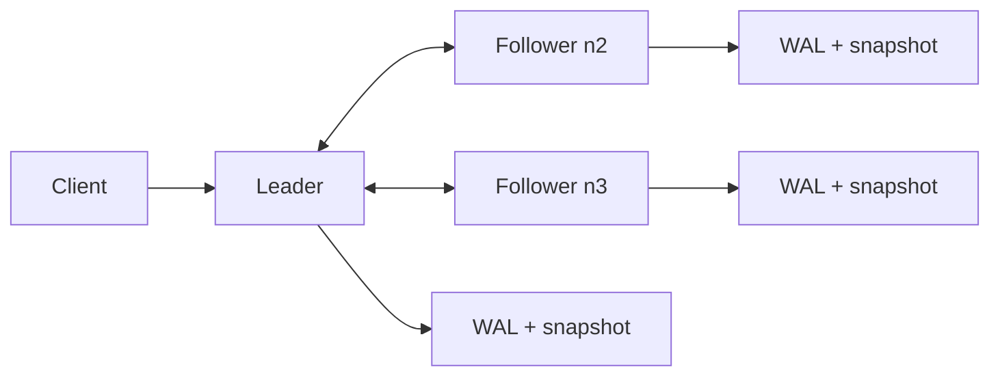

# QuorumKV

A distributed key-value database to be built from scratch in Go, using Raft to study consensus, concurrency, persistence and recovery.

Un database key-value distribuito da costruire da zero in Go, basato su Raft per studiare consenso, concorrenza, persistenza e recupero.

**Status / Stato:** pre-implementation design / progettazione pre-implementativa. No application code, running server, passed database tests or benchmark results / nessun codice applicativo, server utilizzabile, test del database superato o risultato benchmark.

Three local processes; majority 2/3. Roles change through elections. All processes share one Mac and SSD, so physical high availability is outside the guarantee.

Tre processi locali; maggioranza 2/3. I ruoli cambiano con le elezioni. Tutti condividono Mac e SSD: nessuna garanzia di alta disponibilità fisica.

| English | Italiano |
|---|---|
| **Engineering goals:** verifiable Raft safety, linearizability, crash recovery, deterministic testing and explicit trade-offs. | **Obiettivi ingegneristici:** safety Raft verificabile, linearizzabilità, crash recovery, test deterministici e trade-off espliciti. |
| **Planned features:** PUT, GET, DELETE, atomic CAS, durable replication, bounded deduplication, WAL, snapshots and local diagnostics. | **Funzioni previste:** PUT, GET, DELETE, CAS atomico, replica durevole, deduplicazione limitata, WAL, snapshot e diagnostica locale. |
| **Stack:** Go + standard library, HTTP/JSON over TCP, local filesystem, Git, Markdown and Mermaid. No external Raft library. | **Stack:** Go + libreria standard, HTTP/JSON su TCP, filesystem locale, Git, Markdown e Mermaid. Nessuna libreria Raft esterna. |
| **Constraints:** €0 additional spending, existing MacBook Pro M5/32 GB, loopback, offline after tool installation, short bounded tests. | **Vincoli:** 0 € aggiuntivi, MacBook Pro M5/32 GB già disponibile, loopback, offline dopo installazione strumenti, test brevi e limitati. |

## Documentation / Documentazione

| Italiano | English |
|---|---|
| [Documentazione completa](docs/it/README.md) | [Complete documentation](docs/en/README.md) |
| [Requisiti e tracciabilità](docs/it/traceability.md) | [Requirements and traceability](docs/en/traceability.md) |
| [Audit: approvato con condizioni](docs/it/architecture-review.md) | [Audit: approved with conditions](docs/en/architecture-review.md) |
| [Architettura](docs/it/architecture.md) | [Architecture](docs/en/architecture.md) |
| [Roadmap 4–6 mesi](docs/it/implementation-roadmap.md) | [4–6 month roadmap](docs/en/implementation-roadmap.md) |
| [Decisioni ADR](docs/it/adr/README.md) | [Architecture decisions](docs/en/adr/README.md) |
| [Revisione e questioni aperte](docs/it/design-review.md) | [Review and open questions](docs/en/design-review.md) |
| [Consegna e inventario file](docs/it/delivery-report.md) | [Delivery and file inventory](docs/en/delivery-report.md) |

The first implementation milestone will be the deterministic KV state machine after design approval. This repository is an educational portfolio project, not production-ready software.

La prima milestone implementativa sarà la macchina a stati KV deterministica dopo approvazione del progetto. Questo è un progetto didattico e di portfolio, non software pronto per produzione.

**License / Licenza:** not selected; the owner must choose terms before public release / non selezionata; il proprietario dovrà scegliere le condizioni prima della pubblicazione.
