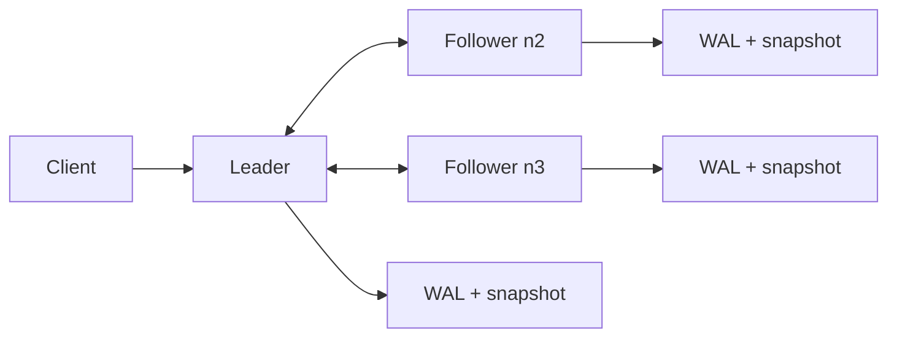

# QuorumKV

A distributed key-value database project in Go. Its deterministic local state machine, ordered applier, local WAL/log recovery and validated loopback RPC/configuration are implemented. Leader election, log replication, distributed commit and ordered committed application are implemented. PUT/DELETE and linearizable GET are available; explicit session profile v2 adds CAS HTTP and bounded replicated deduplication.

Un progetto di database key-value distribuito in Go. Sono implementati macchina a stati locale deterministica, applier ordinato, WAL/recovery log locale e RPC loopback/configurazione validati. Leader election, replica log, commit distribuito e applicazione committed ordinata implementati. Disponibili PUT/DELETE e GET linearizzabile; il profilo sessioni v2 esplicito aggiunge CAS HTTP e deduplicazione replicata limitata.

**Status / Stato — 23 November / novembre 2026:** **M01 COMPLETED**. Local PUT/GET/DELETE/CAS and quota tests pass / operazioni locali e test quote superati. **M02 COMPLETED**: ordered applier, bounded queue and worker lifecycle verified / applier ordinato, coda limitata e lifecycle worker verificati. **M03 COMPLETED**: local WAL and log recovery verified / WAL e recovery log locali verificati. **M04 COMPLETED**: validated peer RPC/configuration and storage-first startup / RPC peer, configurazione e avvio dopo validazione storage verificati. **M05 COMPLETED**: persistent voting, election and empty heartbeats verified / voto persistente, elezione e heartbeat vuoti verificati. **M06 COMPLETED**: durable log replication, conflict resolution and progress tracking / replica log durevole, risoluzione conflitti e tracking. **M07 COMPLETED**: current-term quorum commit and ordered application/replay / commit quorum del termine corrente e applicazione/replay ordinati. **M08 COMPLETED**: PUT/DELETE HTTP, explicit uncertain outcomes, single-attempt test client and OpenAPI subset / HTTP PUT/DELETE, esiti incerti espliciti, test client a singolo tentativo e sottoinsieme OpenAPI. **M09 COMPLETED**: executable process-recovery MVP / MVP eseguibile con recovery processi. **M10 COMPLETED**: logged linearizable GET / GET linearizzabile nel log. **M11 COMPLETED**: CAS HTTP and replicated bounded sessions / CAS HTTP e sessioni replicate limitate. **M12 COMPLETED**: reproducible fault scenarios/replay and local diagnostics / scenari fault/replay riproducibili e diagnostica locale. **M13 PARTIALLY COMPLETED / PARZIALMENTE COMPLETATA**: Phase A and isolated Phase B persistence/recovery completed / Fase A e persistenza/recovery isolati della Fase B completati. Phase C runtime recovery available through explicit library startup; live snapshot cycle gates remain open / Fase C recovery runtime disponibile tramite avvio esplicito di libreria; gate ciclo snapshot live aperti.

Planned distributed architecture / Architettura distribuita prevista:



Three local processes; majority 2/3. Roles change through elections. All processes share one Mac and SSD, so physical high availability is outside the guarantee.

Tre processi locali; maggioranza 2/3. I ruoli cambiano con le elezioni. Tutti condividono Mac e SSD: nessuna garanzia di alta disponibilità fisica.

| English | Italiano |
|---|---|
| **Engineering goals:** verifiable Raft safety, linearizability, crash recovery, deterministic testing and explicit trade-offs. | **Obiettivi ingegneristici:** safety Raft verificabile, linearizzabilità, crash recovery, test deterministici e trade-off espliciti. |
| **Planned features:** PUT, GET, DELETE, atomic CAS, durable replication, bounded deduplication, WAL, snapshots and local diagnostics. | **Funzioni previste:** PUT, GET, DELETE, CAS atomico, replica durevole, deduplicazione limitata, WAL, snapshot e diagnostica locale. |
| **Stack:** Go + standard library, HTTP/JSON over TCP, local filesystem, Git, Markdown and Mermaid. No external Raft library. | **Stack:** Go + libreria standard, HTTP/JSON su TCP, filesystem locale, Git, Markdown e Mermaid. Nessuna libreria Raft esterna. |
| **Constraints:** €0 additional spending, existing MacBook Pro M5/32 GB, loopback, offline after tool installation, short bounded tests. | **Vincoli:** 0 € aggiuntivi, MacBook Pro M5/32 GB già disponibile, loopback, offline dopo installazione strumenti, test brevi e limitati. |

## Documentation / Documentazione

| Italiano | English |
|---|---|
| [M13 Fase C: recovery snapshot + WAL](docs/it/milestone-m13-runtime-recovery.md) | [M13 Phase C: snapshot + WAL recovery](docs/en/milestone-m13-runtime-recovery.md) |
| [M13 Fase B: persistenza e recovery isolato](docs/it/milestone-m13-persistence.md) | [M13 Phase B: persistence and isolated recovery](docs/en/milestone-m13-persistence.md) |
| [M13 Fase A: codec e cattura isolata](docs/it/milestone-m13-preliminary.md) | [M13 Phase A: codec and isolated capture](docs/en/milestone-m13-preliminary.md) |
| [Pre-M13: revisione e readiness condizionata](docs/it/pre-m13-review.md) | [Pre-M13: review and conditional readiness](docs/en/pre-m13-review.md) |
| [M12 completata: fault, replay e osservabilità](docs/it/milestone-m12.md) | [M12 completed: faults, replay and observability](docs/en/milestone-m12.md) |
| [M11 completata: CAS HTTP e deduplicazione](docs/it/milestone-m11.md) | [M11 completed: CAS HTTP and deduplication](docs/en/milestone-m11.md) |
| [M10 completata: GET nel log](docs/it/milestone-m10.md) | [M10 completed: logged GET](docs/en/milestone-m10.md) |
| [M09 completata: recovery processi e MVP](docs/it/milestone-m09.md) | [M09 completed: process recovery and MVP](docs/en/milestone-m09.md) |
| [M08 completata: API e test client](docs/it/milestone-m08.md) | [M08 completed: API and test client](docs/en/milestone-m08.md) |
| [M07 completata: commit e applicazione](docs/it/milestone-m07.md) | [M07 completed: commit and application](docs/en/milestone-m07.md) |
| [M06 completata: replica e conflitti](docs/it/milestone-m06.md) | [M06 completed: replication and conflicts](docs/en/milestone-m06.md) |
| [M05 completata: elezione leader](docs/it/milestone-m05.md) | [M05 completed: leader election](docs/en/milestone-m05.md) |
| [M04 completata: RPC e configurazione](docs/it/milestone-m04.md) | [M04 completed: RPC and configuration](docs/en/milestone-m04.md) |
| [M03 completata: WAL e recovery](docs/it/milestone-m03.md) | [M03 completed: WAL and recovery](docs/en/milestone-m03.md) |
| [M03 preliminare: gate C-02 verificato](docs/it/milestone-m03-preliminary.md) | [Preliminary M03: C-02 verified](docs/en/milestone-m03-preliminary.md) |
| [Revisione pre-M03: readiness condizionata](docs/it/pre-m03-review.md) | [Pre-M03 review: conditional readiness](docs/en/pre-m03-review.md) |
| [M02: applier, test e risultati](docs/it/milestone-m02.md) | [M02: applier, tests and results](docs/en/milestone-m02.md) |
| [M01: implementazione e risultati](docs/it/milestone-m01.md) | [M01: implementation and results](docs/en/milestone-m01.md) |
| [Documentazione completa](docs/it/README.md) | [Complete documentation](docs/en/README.md) |
| [Requisiti e tracciabilità](docs/it/traceability.md) | [Requirements and traceability](docs/en/traceability.md) |
| [Audit: approvato con condizioni](docs/it/architecture-review.md) | [Audit: approved with conditions](docs/en/architecture-review.md) |
| [Architettura](docs/it/architecture.md) | [Architecture](docs/en/architecture.md) |
| [Roadmap 4–6 mesi](docs/it/implementation-roadmap.md) | [4–6 month roadmap](docs/en/implementation-roadmap.md) |
| [Decisioni ADR](docs/it/adr/README.md) | [Architecture decisions](docs/en/adr/README.md) |
| [Revisione e questioni aperte](docs/it/design-review.md) | [Review and open questions](docs/en/design-review.md) |
| [Consegna e inventario file](docs/it/delivery-report.md) | [Delivery and file inventory](docs/en/delivery-report.md) |

M01 provides a sequential, in-memory package with no external dependency. Its 12 tests and 44 subcases pass, including three repeated runs; the implemented package has 100% statement coverage. This is not evidence of distributed correctness. This repository is an educational portfolio project, not production-ready software.

M01 offre un package sequenziale in memoria senza dipendenze esterne. Passano 12 test e 44 sottocasi, anche in tre ripetizioni; il package implementato ha copertura delle istruzioni del 100%. Non è una verifica della correttezza distribuita. Questo è un progetto didattico e di portfolio, non software pronto per produzione.

**License / Licenza:** not selected; the owner must choose terms before public release / non selezionata; il proprietario dovrà scegliere le condizioni prima della pubblicazione.

## Local checks / Verifiche locali

Go 1.27.4; no running cluster is required / non serve un cluster avviato.

```sh
go test -timeout=30s ./...
go vet ./...
go test -race -timeout=30s ./internal/wal ./internal/storagefs ./internal/applier
```

M11 requires new v2 cluster directories; no in-place v1 migration. See the development guide and ADR-010. / M11 richiede nuove directory cluster v2; nessuna migrazione v1 in-place. Vedere guida sviluppo e ADR-010.
