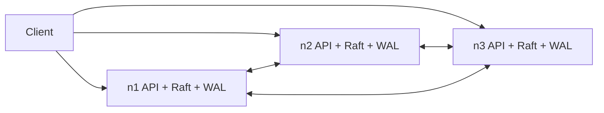

# System architecture

[Index](../README.md) · [Italiano](../../it/diagrams/01-system.md)

**Status: pre-implementation design, revision 0.1 — 18 November 2026. No functionality or measurement has been verified.**

## Design view

Three processes on one Mac, quorum 2, each with its own directory. Client arrows do not imply every node accepts proposals: a follower returns NOT_LEADER.

[Normative specification](../architecture.md). Labels are localized; identifiers, order and conditions match the Italian version.
