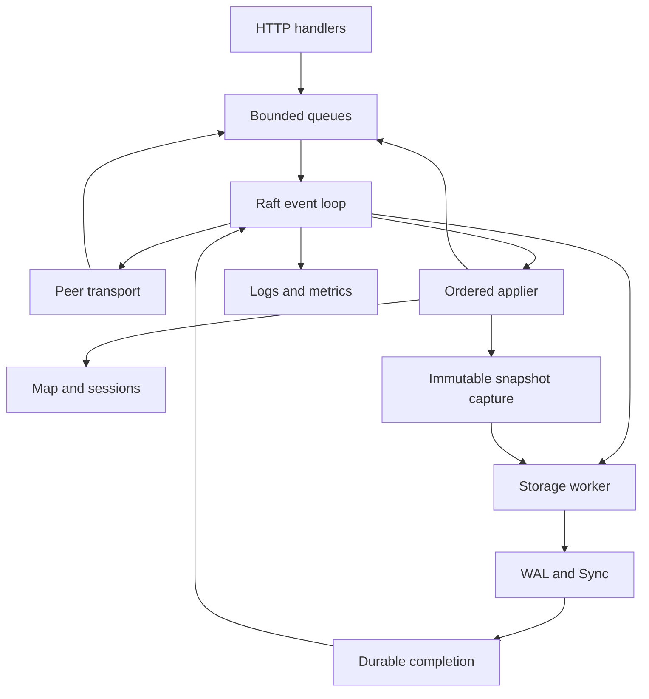

# Internal node architecture

[Index](../README.md) · [Italiano](../../it/diagrams/02-node.md)

**Status: pre-implementation design, revision 0.1 — 18 November 2026. No functionality or measurement has been verified.**

## Design view

The core owns Raft state; the applier owns map and sessions. Persistence-dependent effects wait for durable completion. No handler reads the map directly.

[Normative specification](../architecture.md). Labels are localized; identifiers, order and conditions match the Italian version.
