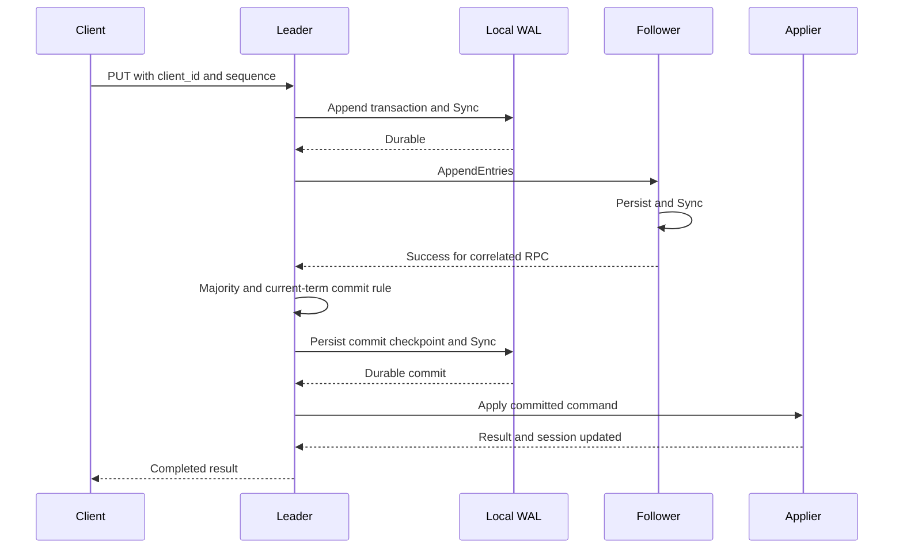

# Write lifecycle

[Index](../README.md) · [Italiano](../../it/diagrams/03-write.md)

**Status: pre-implementation design, revision 0.1 — 18 November 2026. No functionality or measurement has been verified.**

## Design view

The leader counts itself only after Sync. One durable follower plus the leader form a majority. If the client response is lost, retry the identical operation; never infer rollback.

[Normative specification](../api-specification.md). Labels are localized; identifiers, order and conditions match the Italian version.
