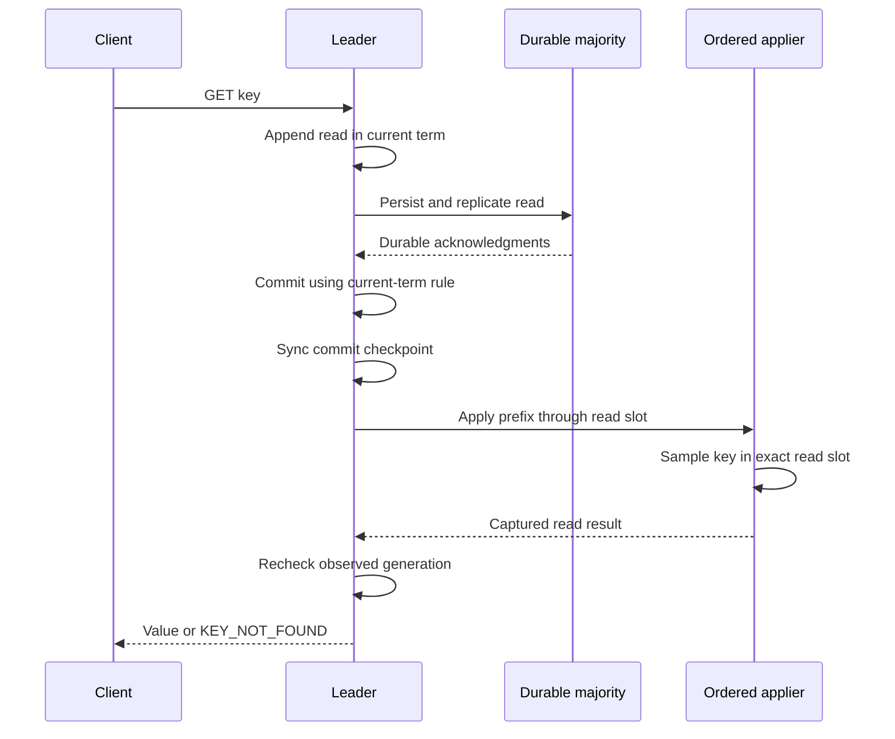

# Linearizable read lifecycle

[Index](../README.md) · [Italiano](../../it/diagrams/04-read.md)

**Status: pre-implementation design, revision 0.1 — 18 November 2026. No functionality or measurement has been verified.**

## Design view

The request does not use a past heartbeat as leadership proof. Without a majority the new barrier cannot commit and the read expires; an observed higher term conservatively prevents a response.

[Normative specification](../consistency-model.md). Labels are localized; identifiers, order and conditions match the Italian version.
