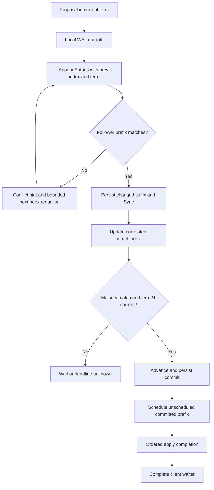

# Replication and commit

[Index](../README.md) · [Italiano](../../it/diagrams/06-replication.md)

**Status: pre-implementation design, revision 0.2 — 18 November 2026. No functionality or measurement has been verified.**

## Design view

Old entries may become committed transitively through a current-term index, never merely by counting old-term replicas. Heartbeats do not truncate suffixes.

[Normative specification](../raft-consensus.md). Labels are localized; identifiers, order and conditions match the Italian version.
