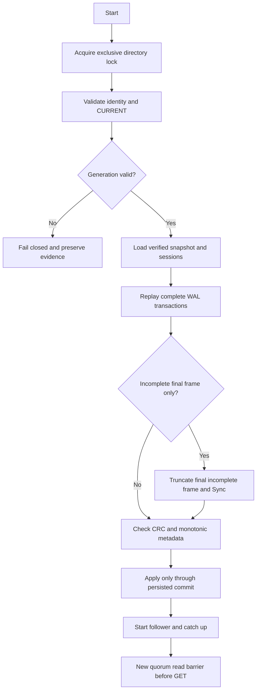

# Crash recovery

[Index](../README.md) · [Italiano](../../it/diagrams/07-recovery.md)

**Status: pre-implementation design, revision 0.1 — 18 November 2026. No functionality or measurement has been verified.**

## Design view

A complete frame with bad checksum fails closed; the incomplete branch applies only in the process-crash model. Present log does not mean committed log.

[Normative specification](../storage-and-recovery.md). Labels are localized; identifiers, order and conditions match the Italian version.
