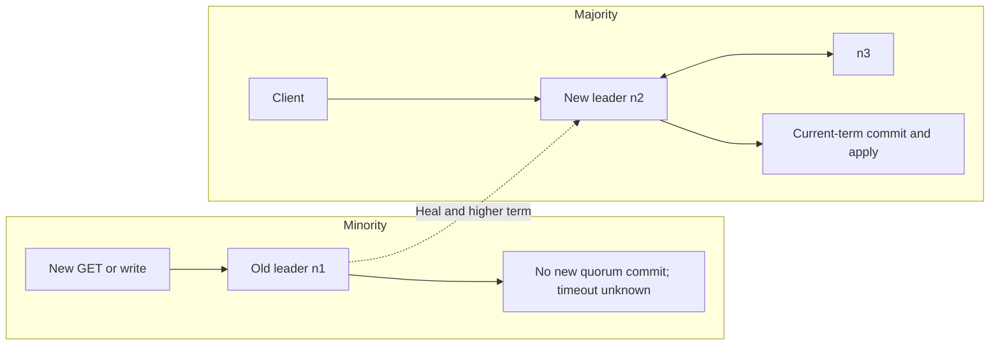

# One-versus-two partition

[Index](../README.md) · [Italiano](../../it/diagrams/08-partition.md)

**Status: pre-implementation design, revision 0.1 — 18 November 2026. No functionality or measurement has been verified.**

## Design view

Leaders in different terms may temporarily believe themselves leader; never two elected in one term. On healing n1 becomes follower and loses only its uncommitted suffix.

[Normative specification](../failure-model.md). Labels are localized; identifiers, order and conditions match the Italian version.
