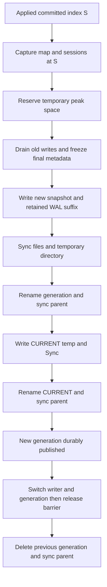

# Persistence and atomic snapshots

[Index](../README.md) · [Italiano](../../it/diagrams/09-snapshot.md)

**Status: pre-implementation design, revision 0.2 — 18 November 2026. No functionality or measurement has been verified.**

## Design view

Concurrent appends are serialized by the worker during final rotation. Nothing is deleted before durable publication; intermediate crashes select the generation referenced by CURRENT.

[Normative specification](../storage-and-recovery.md). Labels are localized; identifiers, order and conditions match the Italian version.

Capture requires worker drain/parking and A=W=L=S, never a concurrent map read. Final storage fencing is distinct from capture fencing and includes updated hard state. [Pre-M13 contract](../pre-m13-review.md); design view, M13 not started.
