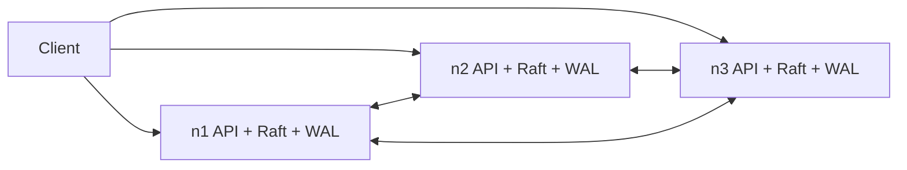

# Architettura generale

[Indice](../README.md) · [English](../../en/diagrams/01-system.md)

**Stato: progetto pre-implementativo, revisione 0.1 — 18 novembre 2026. Nessuna funzionalità o misura è verificata.**

## Vista progettuale

Tre processi sullo stesso Mac, quorum 2, ogni nodo con directory propria. Le frecce client non implicano che ogni nodo accetti proposte: follower risponde NOT_LEADER.

[Specifica normativa](../architecture.md). Le etichette sono tradotte; identificatori, ordine e condizioni corrispondono alla versione inglese.
