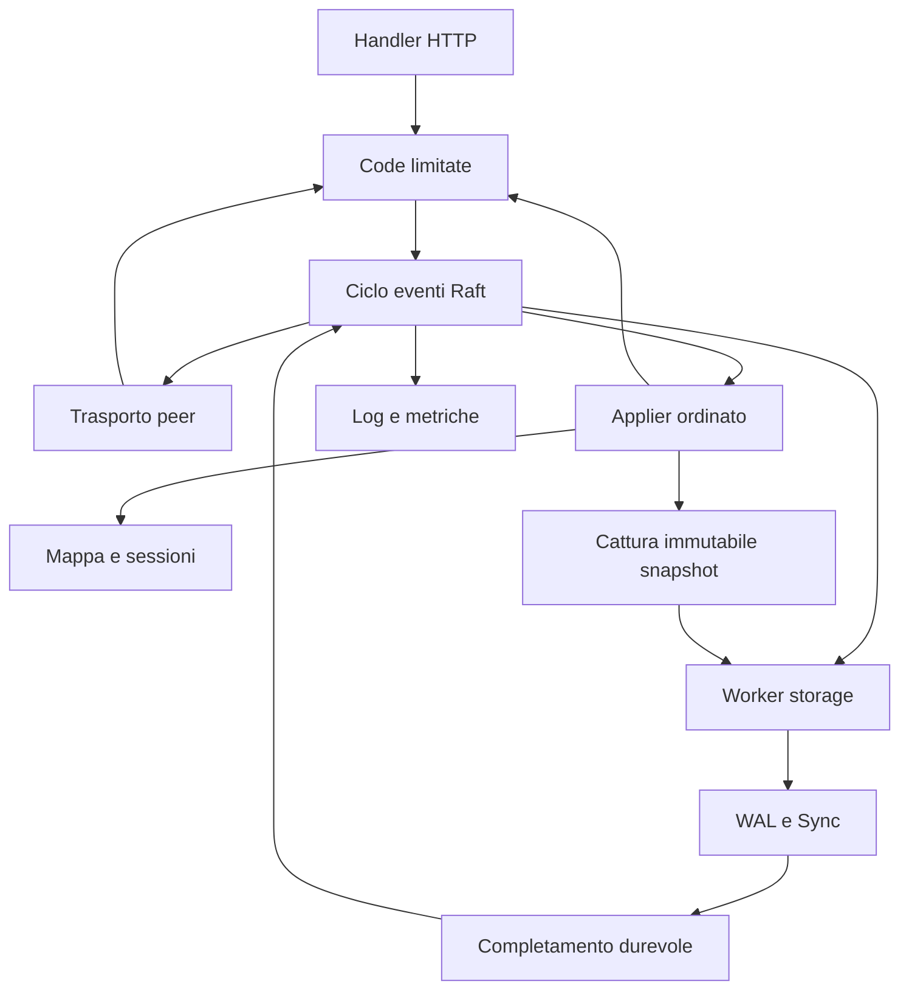

# Architettura interna di un nodo

[Indice](../README.md) · [English](../../en/diagrams/02-node.md)

**Stato: progetto pre-implementativo, revisione 0.1 — 18 novembre 2026. Nessuna funzionalità o misura è verificata.**

## Vista progettuale

Il core possiede stato Raft; l'applier possiede mappa e sessioni. Gli effetti dipendenti da persistenza attendono completamento durevole. Nessun handler legge la mappa direttamente.

[Specifica normativa](../architecture.md). Le etichette sono tradotte; identificatori, ordine e condizioni corrispondono alla versione inglese.
