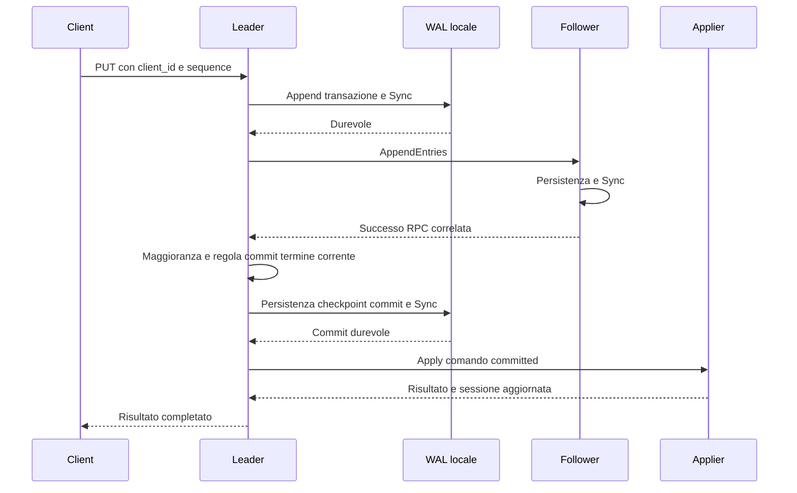

# Ciclo di una scrittura

[Indice](../README.md) · [English](../../en/diagrams/03-write.md)

**Stato: progetto pre-implementativo, revisione 0.1 — 18 novembre 2026. Nessuna funzionalità o misura è verificata.**

## Vista progettuale

Il leader conta la propria copia solo dopo Sync. Un follower durevole più il leader costituiscono maggioranza. Se risposta client persa, ritentare identica operazione; non inferire rollback.

[Specifica normativa](../api-specification.md). Le etichette sono tradotte; identificatori, ordine e condizioni corrispondono alla versione inglese.
