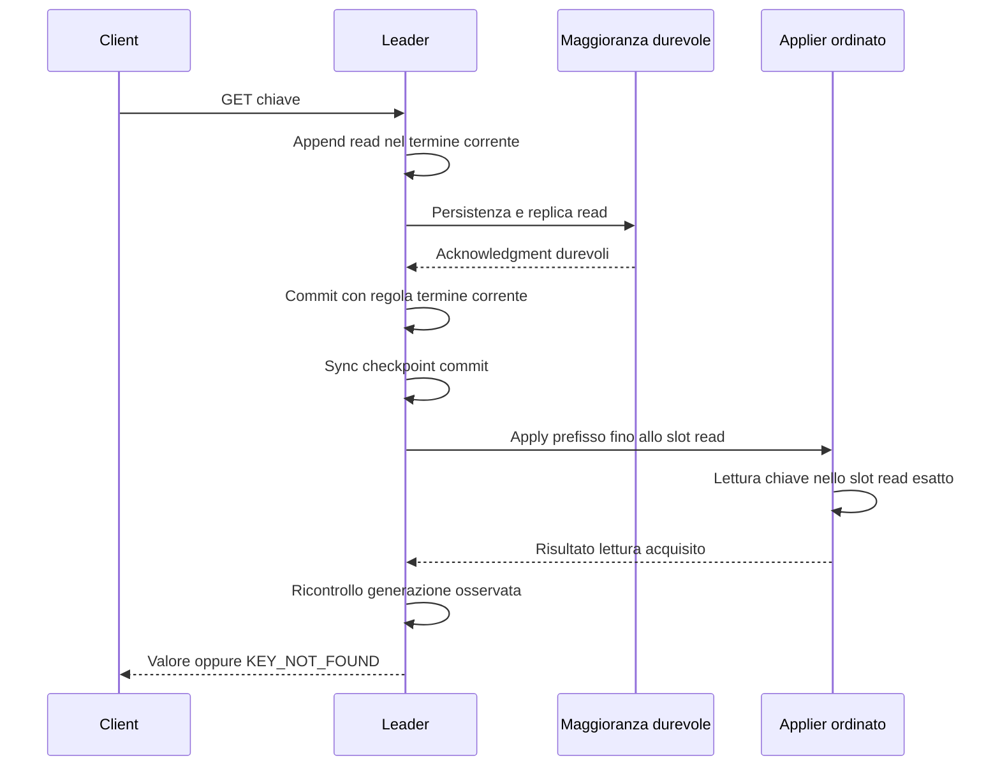

# Ciclo di lettura linearizzabile

[Indice](../README.md) · [English](../../en/diagrams/04-read.md)

**Stato: progetto pre-implementativo, revisione 0.1 — 18 novembre 2026. Nessuna funzionalità o misura è verificata.**

## Vista progettuale

La richiesta non usa un heartbeat passato come prova di leadership. Senza maggioranza la nuova barriera non viene committed e la lettura scade; un termine maggiore osservato impedisce una risposta conservativamente.

[Specifica normativa](../consistency-model.md). Le etichette sono tradotte; identificatori, ordine e condizioni corrispondono alla versione inglese.
