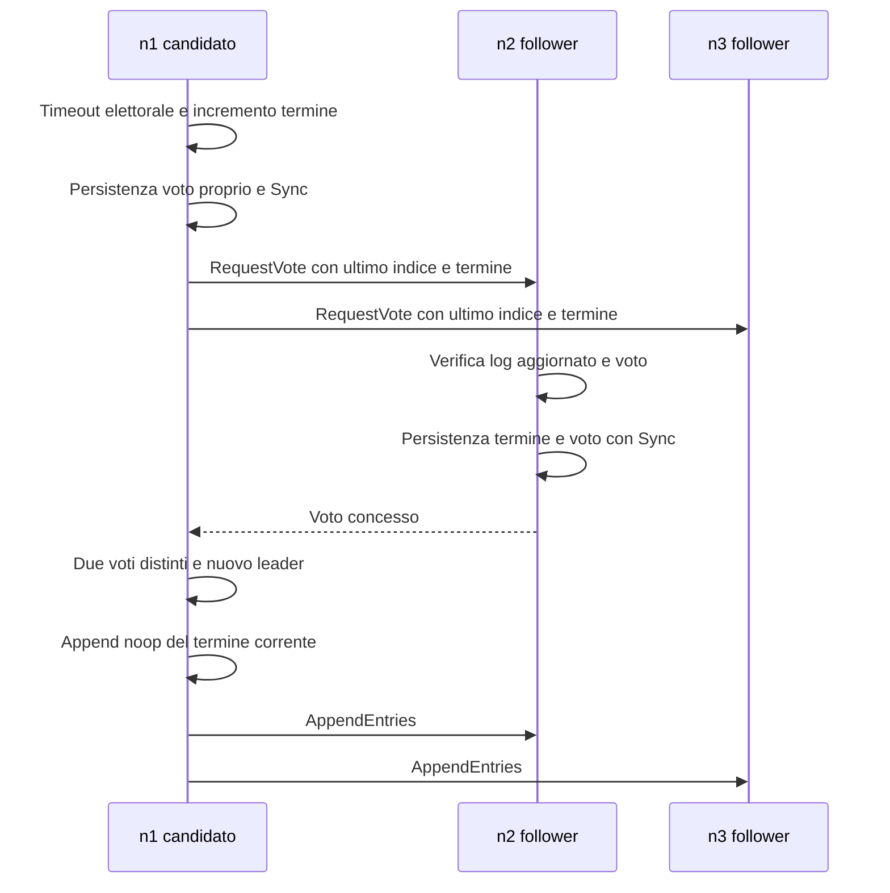

# Elezione del leader

[Indice](../README.md) · [English](../../en/diagrams/05-election.md)

**Stato: progetto pre-implementativo, revisione 0.1 — 18 novembre 2026. Nessuna funzionalità o misura è verificata.**

## Vista progettuale

Il diagramma mostra un percorso vincente, non un tempo massimo. Voto negato non resetta il timer. Split vote richiede nuove elezioni; crash del votante conserva il voto sincronizzato.

[Specifica normativa](../raft-consensus.md). Le etichette sono tradotte; identificatori, ordine e condizioni corrispondono alla versione inglese.
