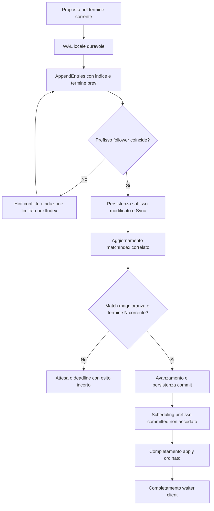

# Replica e commit

[Indice](../README.md) · [English](../../en/diagrams/06-replication.md)

**Stato: progetto pre-implementativo, revisione 0.2 — 18 novembre 2026. Nessuna funzionalità o misura è verificata.**

## Vista progettuale

Entry vecchie possono diventare committed transitivamente tramite un indice corrente, mai contando soltanto repliche di vecchio termine. Heartbeat non tronca suffissi.

[Specifica normativa](../raft-consensus.md). Le etichette sono tradotte; identificatori, ordine e condizioni corrispondono alla versione inglese.
