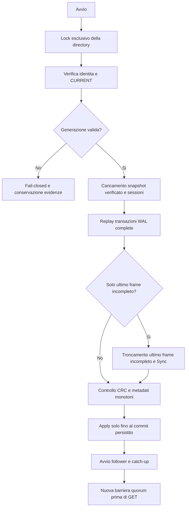

# Recupero dopo crash

[Indice](../README.md) · [English](../../en/diagrams/07-recovery.md)

**Stato: progetto pre-implementativo, revisione 0.1 — 18 novembre 2026. Nessuna funzionalità o misura è verificata.**

## Vista progettuale

Checksum errato di frame completo porta a fail-closed; il ramo incompleto vale solo nel modello crash di processo. Log presente non equivale a log committed.

[Specifica normativa](../storage-and-recovery.md). Le etichette sono tradotte; identificatori, ordine e condizioni corrispondono alla versione inglese.
