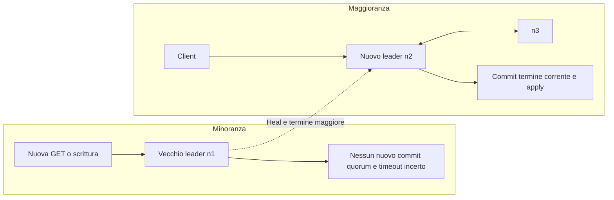

# Partizione uno contro due

[Indice](../README.md) · [English](../../en/diagrams/08-partition.md)

**Stato: progetto pre-implementativo, revisione 0.1 — 18 novembre 2026. Nessuna funzionalità o misura è verificata.**

## Vista progettuale

Leader di termini diversi possono temporaneamente credersi leader; mai due eletti nello stesso termine. Al heal n1 diventa follower e perde solo suffisso non committed.

[Specifica normativa](../failure-model.md). Le etichette sono tradotte; identificatori, ordine e condizioni corrispondono alla versione inglese.
