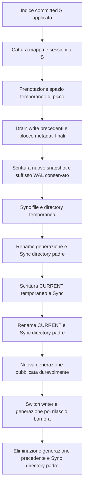

# Persistenza e snapshot atomici

[Indice](../README.md) · [English](../../en/diagrams/09-snapshot.md)

**Stato: progetto pre-implementativo, revisione 0.2 — 18 novembre 2026. Nessuna funzionalità o misura è verificata.**

## Vista progettuale

Append concorrenti sono serializzati dal worker durante rotazione finale. Nessuna cancellazione precede la pubblicazione durevole; crash intermedi scelgono la generazione referenziata da CURRENT.

[Specifica normativa](../storage-and-recovery.md). Le etichette sono tradotte; identificatori, ordine e condizioni corrispondono alla versione inglese.
